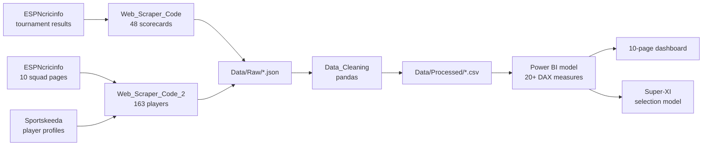

# 🏏 Cricket Data Analysis — ICC Cricket World Cup 2023

An end-to-end analytics project that scrapes every scorecard from the 2023 ICC Cricket World Cup,
transforms the raw HTML into an analysis-ready data model, and drives an interactive Power BI
dashboard plus a rule-based **"Super-XI"** team-selection model.

**Stack:** Python · BeautifulSoup · pandas · Power BI (DAX) · Excel

| | |
|---|---|
| **Matches covered** | 48 (full tournament, group stage → final) |
| **Teams** | 10 |
| **Squad players profiled** | 163 |
| **Player-innings records** | 1,426 (852 batting · 574 bowling) |
| **Data sources** | ESPNcricinfo (scorecards, squads) · Sportskeeda (player images) |
| **Dashboard** | 6-table model · 20+ DAX measures · 10 report pages |

---

## Pipeline



### 1. Match scraping — [`Code/Web_Scraper_Code.ipynb`](Code/Web_Scraper_Code.ipynb)

Starts from the tournament *team-match-results* page, parses the results table to harvest all **48
scorecard URLs**, reverses them into chronological order, then visits each scorecard and parses its
four `<tbody>` blocks (innings-1 batting, innings-1 bowling, innings-2 batting, innings-2 bowling).

Two fields the analysis depends on **are not present in the source HTML** and had to be derived:

- **Batting position** — inferred from row order within each innings table, since scorecards list
  batters in the order they came to the crease.
- **Bowling team** — inferred from cricket logic: the side batting second bowls first, so the team
  list is reversed before tagging bowling rows.

The parser also strips `\xa0` non-breaking spaces, skips blank cells, and discards the trailing
non-player rows (extras / totals / did-not-bat) that follow each innings table.

### 2. Squad & player scraping — [`Code/Web_Scraper_Code_2.ipynb`](Code/Web_Scraper_Code_2.ipynb)

Scrapes 10 team squad pages for name, age, batting hand, bowling style and playing role, then
scrapes a **second source** for player headshots by reading the pipe-delimited
`data-img-fallbacks` attribute and taking the first HTTPS URL.

### 3. Cleaning & transformation — [`Code/Data_Cleaning.ipynb`](Code/Data_Cleaning.ipynb)

- **Free-text dismissals → binary flag.** Raw values such as `"c Mitchell b Santner"` are collapsed
  to `out` / `not out`. This is what makes a *correct* batting average computable — runs ÷ dismissals
  rather than runs ÷ innings. Dividing by innings would systematically understate not-out players,
  precisely the finishers and all-rounders the selection model needs to rank.
- **Synthetic join key.** No shared match identifier existed across the three scraped tables, so a
  sequential `match_number` is generated by detecting match boundaries in the scraped row stream.
  This key is what makes the Power BI relationships work.
- `Scorecard` is renamed to `match_id`, and match dates are replaced by `match_number` so the
  dashboard's form charts can order innings chronologically.

### 4. Final quality pass (Excel)

Three corrections were applied to `batting_processed.csv` after export:

- Removed **21 residual `Extras` / `TOTAL` rows** that the scraper's row-trimming heuristic missed.
- Coerced strike rate to a numeric type.
- Replaced the `-` strike rate printed for two 0-ball innings with `0`.

> Re-running the notebooks reproduces `bowling_processed.csv`, `matchinfo_processed.csv` and
> `playerinfo_processed.csv` byte-for-byte, and `batting_processed.csv` up to these three edits.

---

## Dashboard

`Worldcup_Stats_Dashboard.pbix` — open with [Power BI Desktop](https://powerbi.microsoft.com/desktop/) (free).
The data is cached inside the file, so every page renders immediately on open; a *Refresh* would
re-point at the CSV paths from the machine it was authored on.

**Model (6 tables):** `batting`, `bowling`, `match info`, `player_info`, `player_images`, and a
dedicated `Key_Measures` table that keeps all measures separate from the fact tables.

**Measures (20+):** `Batting_Average`, `Strike_Rate`, `Boundary_%`, `Dot_Ball_%`, `Economy`,
`Bowling_Average`, `Wickets`, `Runs_Conceded`, `Balls_Bowled`, `Total_Runs`, `Total_Balls_Faced`,
`Total_Innings_Batted`, `Total_Innings_Bowled`, `Average_Balls_Faced`, `Average_Time`,
`AverageWicketsPerMatch`, plus squad-level `Super-XI Economy` and `Super-XI_Batting Average` that
score the selected eleven *as a unit*.

**Pages (10):**

| Page | Purpose |
|---|---|
| Wicket-Keeper | Role shortlist + selection evidence |
| Opener's | Role shortlist + selection evidence |
| Middle-Order | Role shortlist + selection evidence |
| Batting-All-Rounder | Role shortlist + selection evidence |
| Bowling-All-Rounder | Role shortlist + selection evidence |
| Bowlers | Role shortlist + selection evidence |
| Final-12 | The selected squad with aggregate team metrics |
| batting-info / bowling-info / all_rounder-info | Free-form explorer pages (pivot tables) |

Each of the six role pages follows the same analytic template:

1. **Ranked candidate table** — every eligible player with the metrics relevant to that role
2. **Strike rate vs. batting average scatter** — the central trade-off view
3. **Four KPI cards** — headline metrics for the selected player
4. **Two area charts** — batting average and strike rate across the 48-match timeline (form over time)

<!-- TODO: add dashboard screenshots here, e.g.

-->

---

## The Super-XI selection model

A deterministic, documented rule engine rather than a black box. Full specification in
[`Rules.txt`](Rules.txt) and [`Metrics Used.txt`](Metrics%20Used.txt).

**How it works**

- Six role archetypes mapped to batting positions 1–11.
- **Hard eligibility filters** per role — openers need avg ≥ 50 and ≥ 7 innings; the middle order
  needs avg ≥ 45 and SR ≥ 90; bowlers need economy ≤ 5.5, ≥ 15 wickets and ≥ 7 innings bowled.
- An explicit **metric precedence order** for tie-breaking within each role (for bowlers:
  wickets = economy > dot-ball % > balls bowled).
- **±1 positional flexibility**, so a strong player isn't excluded by a rigid slot — deliberately
  *not* applied to openers, because opening is a different game state.
- **Sequential selection with a dependency:** the wicket-keeper is locked first (mandatory slot) and
  the bowlers are picked **last**, conditioned on the all-rounders' bowling type. Squad balance is
  treated as a constraint, so the final attack keeps a sensible pace/spin mix instead of simply
  taking the four highest-ranked bowlers.
- Thresholds were calibrated from role-level population averages plus iteration.

### Selected XI

Stats below are computed from this repo's processed data (tournament totals).

| # | Player | Role | Inn | Runs | Avg | SR | Wkts | Econ |
|---|---|---|---:|---:|---:|---:|---:|---:|
| 1 | Rohit Sharma *(C)* | Opener | 11 | 597 | 54.27 | 125.95 | – | – |
| 2 | Quinton de Kock *(Wk)* | Opener / Keeper | 10 | 594 | 59.40 | 107.03 | – | – |
| 3 | Virat Kohli | Middle order | 11 | 765 | 95.62 | 90.32 | – | – |
| 4 | Daryl Mitchell | Middle order | 9 | 552 | 69.00 | 111.07 | – | – |
| 5 | Shreyas Iyer | Middle order | 11 | 530 | 66.25 | 113.25 | – | – |
| 6 | Glenn Maxwell | Batting all-rounder | 9 | 400 | 66.67 | 150.38 | 6 | 4.83 |
| 7 | Ravindra Jadeja | Bowling all-rounder | 5 | 120 | 40.00 | 101.69 | 16 | 4.28 |
| 8 | Mohammed Shami | Bowler | 4 | 10 | 3.33 | 50.00 | 24 | 5.30 |
| 9 | Jasprit Bumrah | Bowler | 3 | 18 | 9.00 | 62.07 | 20 | 4.08 |
| 10 | Josh Hazlewood | Bowler | 4 | 2 | 2.00 | 66.67 | 16 | 4.82 |
| 11 | Adam Zampa | Bowler | 6 | 48 | 16.00 | 80.00 | 23 | 5.36 |

*(C) Captain · (Wk) Wicket-keeper*

The resulting attack is three seamers (Shami, Bumrah, Hazlewood), one frontline spinner (Zampa) and
two spin-capable all-rounders (Jadeja, Maxwell) — the balance the selection order is designed to produce.

---

## Repository structure

```
├── Code/
│   ├── Web_Scraper_Code.ipynb      # Match scorecards → batting/bowling/match JSON
│   ├── Web_Scraper_Code_2.ipynb    # Squads + player images
│   └── Data_Cleaning.ipynb         # pandas transformation → CSVs
├── Data/
│   ├── Raw/                        # Scraper output (JSON)
│   ├── Processed/                  # Analysis-ready CSVs (Power BI sources)
│   ├── flags/                      # Country flag URL lookup
│   └── logos/                      # Dashboard icons
├── Worldcup_Stats_Dashboard.pbix   # Power BI report
├── Rules.txt                       # Super-XI selection methodology
├── Metrics Used.txt                # Per-role filters and metric precedence
└── Super-XI.txt                    # Final selected eleven
```

### Processed datasets

| File | Rows | Grain |
|---|---:|---|
| `batting_processed.csv` | 852 | One row per batter per innings |
| `bowling_processed.csv` | 574 | One row per bowler per innings |
| `playerinfo_processed.csv` | 163 | One row per squad player |
| `matchinfo_processed.csv` | 48 | One row per match |
| `player_images.csv` | 150 | Player → headshot URL |

---

## Running it

```bash
pip install -r requirements.txt
```

Then run the notebooks in order:

1. `Code/Web_Scraper_Code.ipynb` — writes `Data/Raw/batting_summary.json`, `bowling_summary.json`, `match_summaries.json`
2. `Code/Web_Scraper_Code_2.ipynb` — writes `Data/Raw/player_info.json` and `Data/Processed/player_images.csv`
3. `Code/Data_Cleaning.ipynb` — writes the processed CSVs

Each notebook resolves the project root automatically, so it runs from any working directory. The
repo ships with the scraped data already in place, so you can skip straight to step 3 — or straight
to the dashboard.

> **Note:** the scrapers target ESPNcricinfo's 2023 page structure and depend on specific CSS class
> names. They are preserved here as a record of how this dataset was built; a site redesign will
> break them.

---

## Known limitations

- **Small sample per player** (9–11 innings). Thresholds were calibrated by inspection against
  role-level averages, not cross-validated.
- **No strength-of-opposition, venue or conditions adjustment** — an average of 50 against weaker
  attacks is weighted the same as one against the best.
- **Scrapers are tightly coupled** to ESPNcricinfo's CSS class names and `<tbody>` ordering.
- **No rate limiting, retry logic or response caching** on the HTTP layer.

## Possible extensions

- `requests.Session` with retry/backoff and cached raw HTML
- Schema validation (Pandera/Pydantic) and parser unit tests, so a layout change fails loudly
  instead of silently yielding empty rows
- Move the cleaning out of notebooks into parameterized modules; publish to Power BI Service with
  scheduled refresh
- Replace threshold filters with a weighted scoring model or a constrained optimizer over the XI,
  and backtest the selected side against actual tournament outcomes

---

*Data scraped from ESPNcricinfo and Sportskeeda for educational and analytical purposes.*
